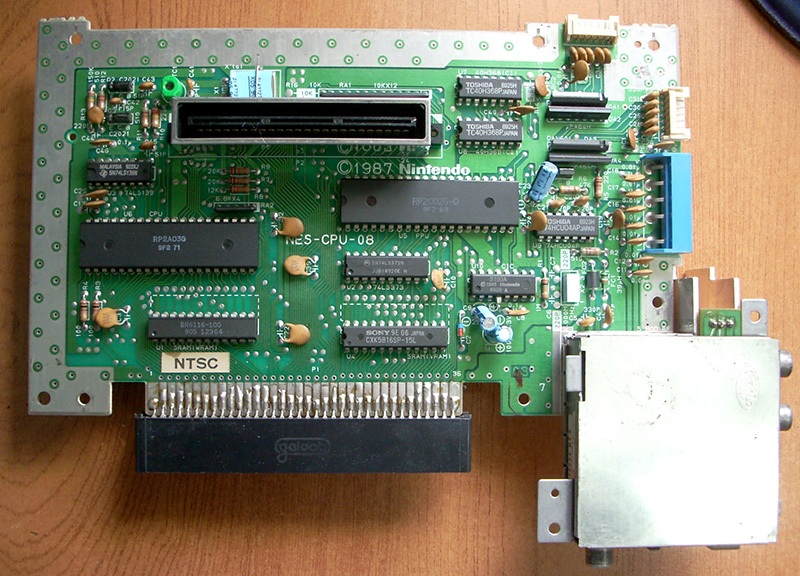

# nes-pacs

Este proyecto tiene como objetivo emular el hardware del Nintendo
Entertainment System (NES) en un FPGA Altera Cyclone V.

[[img source]](https://133fsb.wordpress.com/2009/11/28/restoring-a-nice-famiclone-part-2)

## Antecedentes

El NES utiliza un procesador de 8 bits, con un espacio de direcciones de 16 bits, basado en
el MOS Technology 6502.

## Objetivos

Escribir implementaciones funcionales de los siguientes componentes del NES en
SystemVerilog:

- Procesador Ricoh 2A03 (incluyendo la unidad de procesamiento de audio)
- Unidad de Procesamiento de Imagen del NES (PPU)

Implementar un conjunto de pruebas de regresión para garantizar que la CPU y la PPU ejecuten
las instrucciones con precisión. Esto comenzará con la escritura de simulaciones en quartus
y finalizará cargando juegos de NES en el fpga.

## Requisitos

Este proyecto utiliza las siguientes herramientas:

- [GNU Make](https://gnu.org/software/make)
- [Verilator](http://veripool.org/wiki/verilator)
- [xa (xa65)](http://www.floodgap.com/retrotech/xa)

## Equipo del Proyecto

Este proyecto se realiza como parte del curso [Embedded
Systems](http://www.cs.columbia.edu/~sedwards/classes/2016/4840-spring/index.html)
(CSEE 4840) de Stephen Edwards en la Universidad de Columbia.

- [Philip Schiffrin](https://github.com/nethacker11) (pjs2186)
- [Akira Baruah](https://github.com/akira-baruah) (akb2158)
- [Chaiwen Chou](https://github.com/chaiwen) (cc3636)
- [Sean Liu](https://github.com/seansliu) (sl3497)

## Referencias
*¡Próximamente!*
